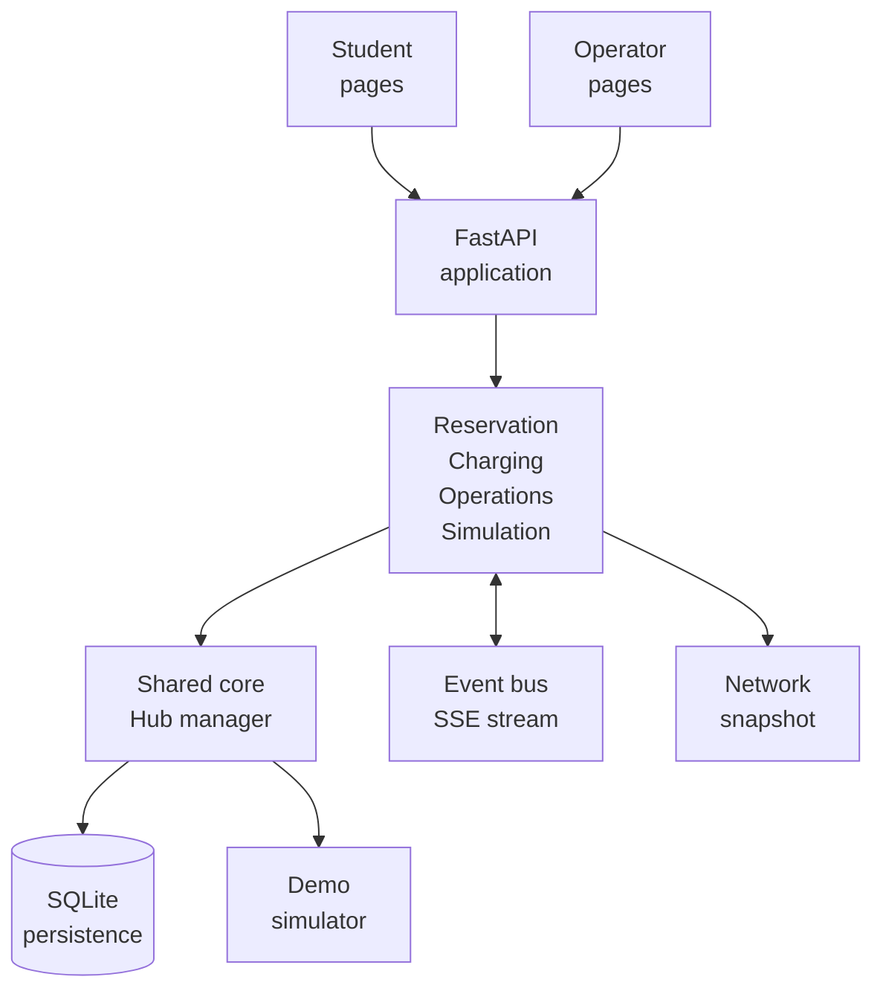

# Smart E-Mobility Hub

A web application for coordinating shared electric vehicles, parking, charging hubs, and daily operations across a university district. The backend uses FastAPI and the frontend uses plain HTML, CSS, and JavaScript. Demo state is persisted in SQLite and updated by a simulator.

## Contents

- [Overview](#overview)
- [Features](#features)
- [System architecture](#system-architecture)
- [Actors and core capabilities](#actors-and-core-capabilities)
- [Team and modules](#team-and-modules)
- [Project structure](#project-structure)
- [UI/UX and languages](#uiux-and-languages)
- [Requirements](#requirements)
- [Quick start](#quick-start)
- [Demo workflow](#demo-workflow)
- [Google Sign-In and phone access](#google-sign-in-and-phone-access)
- [API and data](#api-and-data)
- [Run checks](#run-checks)
- [Team workflow](#team-workflow)
- [Related documentation](#related-documentation)

## Overview

Smart E-Mobility Hub coordinates shared electric mobility resources across a university district. A Hub may represent a Metro station, dormitory, campus, library, or service area and can contain vehicles, parking spaces, and charging points. The application focuses on last-mile mobility workflows and operational coordination; devices and live network conditions are simulated.

## Features

- Explore Hubs and view vehicle, parking-space, and charging-point availability.
- Reserve a shared vehicle or parking space, pick up and return vehicles, view trips, and report issues.
- Submit charging requests and view charging status and schedules.
- Use operator pages to monitor the network, handle incidents, redistribute vehicles, and run What-if simulations.
- Switch between English and Vietnamese, light and dark themes, and responsive mobile layouts.
- Simulate device data and receive live updates over Server-Sent Events (SSE).

Some payment, smart-lock, and device workflows are simulations for demonstration. Do not use them to collect real payments or control physical devices.

## System architecture



The frontend is served by FastAPI under `/app/`; shared browser libraries are served under `/shared/`. Backend modules use the shared network state and event bus. SQLite persists application state between restarts, while the simulator generates demo telemetry.

## Actors and core capabilities

| Actor | Capabilities |
|---|---|
| Student | Find a Hub, inspect availability, reserve a vehicle or parking space, pick up and return a vehicle, report issues, and request charging. |
| Operator | Monitor Hubs, manage alerts and incidents, coordinate vehicle redistribution, oversee charging, and run What-if scenarios. |
| Simulator | Generate vehicle and charging telemetry and support repeatable demo scenarios. |

## Team and modules

| Area | Source | Guide |
|---|---|---|
| Reservation and trips | `src/backend/modules/reservation/` | [Member 1 TODO](docs/todo/member1.md) |
| Charging and scheduling | `src/backend/modules/charging/` | [Member 2 TODO](docs/todo/member2.md) |
| Operations and monitoring | `src/backend/modules/operations/` | [Member 3 TODO](docs/todo/member3.md) |
| What-if simulation | `src/backend/modules/simulation/` | [Member 4 TODO](docs/todo/member4.md) |
| Shared core and integration | `src/backend/core/`, `src/backend/app.py` | [Member 5 TODO](docs/todo/member5.md) |

## Project structure

```text
configs/                 Hub data and demo scenario configuration
data/                    Local SQLite database (not committed)
docs/                    Guides, conventions, and module contracts
scripts/                 Backend/demo startup and data reset commands
src/backend/app.py       FastAPI entry point, static frontend, shared API
src/backend/core/        Authentication, shared state, persistence, SSE, simulator
src/backend/modules/     Reservation, charging, operations, simulation
src/frontend/            Login, student, operator pages, and assets
src/shared/              API client, i18n, SSE, and shared map helpers
tests_js/                Frontend client checks
```

## UI/UX and languages

- The interface supports English and Vietnamese; language preference is saved in the browser.
- Light and dark themes are available from the top navigation.
- Student and operator pages adapt to phone and desktop screens.
- Visible text should use shared keys in `src/shared/i18n.js`; follow the [UI guidelines](docs/ui-guidelines.md) when adding or updating pages.

## Requirements

- Python 3.10 or newer.
- A modern web browser.
- Internet access for map tiles, GIS libraries, and Google Sign-In.
- Ngrok only if you need to access the demo over HTTPS from a phone.

## Quick start

### Windows

Open PowerShell in the project directory:

```powershell
cd D:\HCMUT\CNPM\smart-e-mobility-hub
py -m venv .venv
Set-ExecutionPolicy -Scope Process -ExecutionPolicy RemoteSigned
.\.venv\Scripts\Activate.ps1
python -m pip install -r requirements.txt
```

Create a local configuration file once. If `.env` already exists, keep it and edit only the variables you need:

```powershell
if (-not (Test-Path .env)) { Copy-Item .env.example .env }
notepad .env
```

Start the server from the project root:

```powershell
python -m uvicorn src.backend.app:app --reload --port 8000
```

You can also run `scripts\run_demo.bat` to create the virtual environment, install dependencies, and start the demo. Use `scripts\run_backend.bat` after the environment and dependencies are ready. Keep the server terminal open while using the app.

### macOS or Linux

```bash
python3 -m venv .venv
source .venv/bin/activate
python -m pip install -r requirements.txt
cp .env.example .env   # create only if it does not already exist
python -m uvicorn src.backend.app:app --reload --port 8000
```

Alternatively, run `bash scripts/run_demo.sh`. It creates `.venv` and `.env` if needed, then starts the app. The `--fresh` option deletes the current demo SQLite database so the next start loads seed data; use it only when you intend to discard saved demo data. The `--tunnel` option attempts to start ngrok if it is installed and configured.

## Demo workflow

1. Start the backend and wait until the server is ready.
2. Open the sign-in page:
   - Home: <http://localhost:8000/> (redirects to `/app/`).
   - Sign in: <http://localhost:8000/app/login.html>.
3. Sign in with Google if OAuth is configured. Otherwise, set `DEMO_MODE=true` in `.env` and choose a demo account on the sign-in page.
4. Students can explore Hubs, reserve vehicles or parking, submit charging requests, and view trips and wallet activity.
5. Operators can monitor the network, manage incidents, and run simulations.
6. At the end of a demo, use **Reset demo** in the Operator dashboard to restore seed data. Data is stored in `data/hub.db`, so restarting the server does not automatically clear it.

Run the demo with one backend worker. Shared application state is held in the server process and SQLite; do not run multiple server instances against the same port and database.

## Google Sign-In and phone access

### Configure Google OAuth

1. Open [Google Cloud Console](https://console.cloud.google.com/) and select the correct project.
2. In Google Auth Platform, create or select an OAuth client of type **Web application**.
3. Under **Authorized JavaScript origins**, add each exact origin you use, such as `http://localhost:8000` and the tunnel's HTTPS origin. Include only the scheme, hostname, and port when applicable. Do not include `/app/login.html` or a trailing slash.
4. Set the matching Client ID as `GOOGLE_CLIENT_ID` in `.env`, then restart the backend.
5. If the tunnel domain changes, add its new origin to the same OAuth client and confirm the backend uses that client's ID.

> The current sign-in page uses Google Identity Services in popup mode and the backend verifies the returned ID token. This flow does not require an Authorized redirect URI. A redirect-based OAuth flow would require a separate redirect URI.

### Access the app from a phone over HTTPS

1. Start the backend on port `8000` and leave it running.
2. Open a second terminal and start ngrok:

   ```powershell
   ngrok http 8000
   ```

3. Open the HTTPS URL shown by ngrok on your phone. Add `/app/` to open the app directly; the root path `/` redirects to `/app/`.
4. On a Free ngrok account, `ngrok http 8000` uses the static dev domain assigned to your account.
5. Allow location access in the phone's browser. The map needs an Internet connection to load OpenStreetMap tiles.

To troubleshoot, first check `http://localhost:8000/api/health`, then `http://localhost:8000/app/`. Test the tunnel only after both local URLs work. Forward one tunnel to the backend on port `8000`.

See the [HTTPS tunnel guide](docs/demo-tunnel.md). Do not commit or share `.env`, OAuth client secrets, signing keys, payment secrets, or payment account details.

## API and data

| Path | Purpose |
|---|---|
| `/` | Redirects to `/app/` |
| `/app/` | Web application |
| `/docs` | Swagger API documentation |
| `/api/health` | Server, simulator, and persistence status |
| `/api/hubs` | Hub status list |
| `/api/stream` | Server-Sent Events stream |

Business routers are grouped under `/api/reservation`, `/api/charging`, `/api/operator`, and `/api/simulation`, alongside shared endpoints. Open `/docs` while the server is running for the complete endpoint list and interactive API tools.

`HubNetworkManager` keeps the active state in memory. SQLite at `data/hub.db` stores a persistent copy and restores it on startup. Set `DATABASE_PATH` in `.env` to change the database location. See [docs/database.md](docs/database.md) for details.

## Run checks

Run these commands from the project root:

```powershell
python -m pytest
node tests_js/client.test.js
```

Test counts are intentionally omitted here because the test suite changes with the code.

## Team workflow

Current ownership assignments and course deliverables are tracked in [TEAM_TODO.md](TEAM_TODO.md). Keep shared state changes within the network lock, preserve module API contracts, and add new visible UI text to both language dictionaries.

## Related documentation

- [Team plan and ownership](TEAM_TODO.md)
- [HTTPS tunnel guide](docs/demo-tunnel.md)
- [SQLite persistence and reset](docs/database.md)
- [Shared module contract](docs/shared-contract.md)
- [UI, translation, and accessibility guidelines](docs/ui-guidelines.md)
- [Member 1 TODO – Reservation & Trip](docs/todo/member1.md)
- [Member 2 TODO – Charging](docs/todo/member2.md)
- [Member 3 TODO – Operations](docs/todo/member3.md)
- [Member 4 TODO – Simulation](docs/todo/member4.md)
- [Member 5 TODO – Integration](docs/todo/member5.md)
- [Python dependencies](requirements.txt)
- [Backend source](src/backend/)
- [Frontend source](src/frontend/)

## License

Released under the [MIT License](LICENSE).
